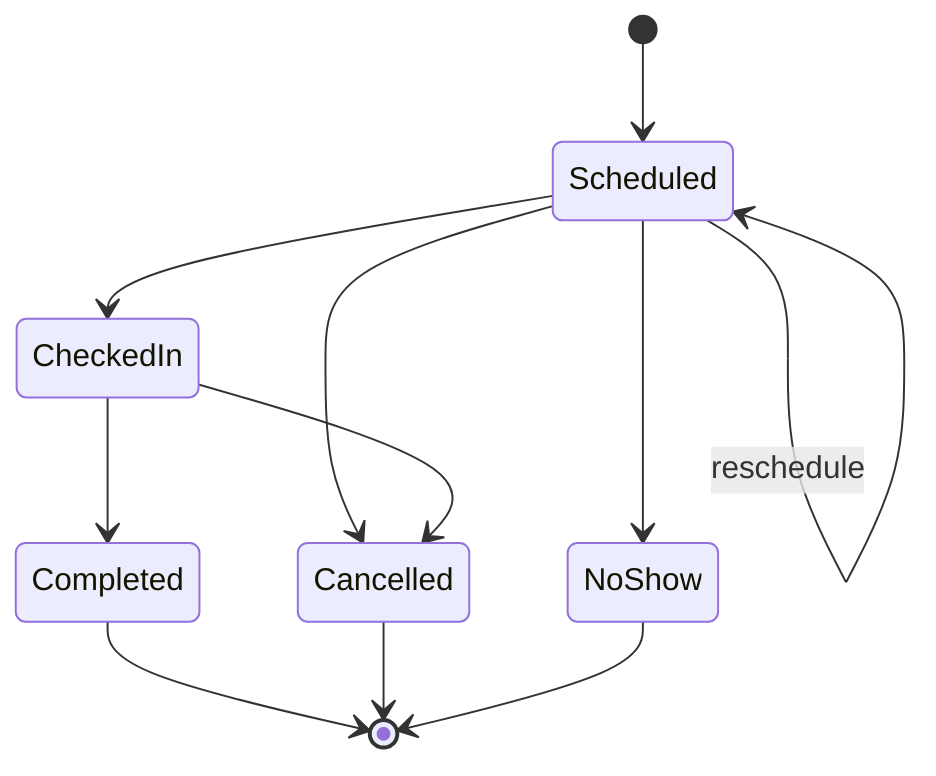

# MediCore Hospital Management System — Software Requirements Specification

**Northbridge Medical Center** · Backend Web API · Phase 1

> [!NOTE]
> This Markdown file is the working copy of the specification. The original Word document is kept in [`source/MediCore_HMS_SRS_v1.0.docx`](source/MediCore_HMS_SRS_v1.0.docx). Future changes are made here and tracked through Git history.

| Item | Value |
| --- | --- |
| **Client** | Northbridge Medical Center (fictional client, outpatient clinic network) |
| **Product** | MediCore HMS: backend REST Web API |
| **Document type** | Software Requirements Specification |
| **Version** | 1.0 |
| **Status** | Approved for development |
| **Date** | 21 November 2026 |
| **Prepared by** | Business Analysis team |
| **Intended readers** | Backend developers, QA engineers, technical lead, product owner |

> [!NOTE]
> This is a simulated client specification created for a portfolio project. The client, people and processes are fictional, but the requirements follow the structure and level of detail of a real company SRS.

## Document control

| Version | Date | Author | Change |
| --- | --- | --- | --- |
| 0.1 | 03 Nov 2026 | Business Analyst | Initial draft after stakeholder workshops |
| 0.5 | 12 Nov 2026 | Business Analyst, Tech Lead | Business rules and roles reviewed with clinic management |
| 0.9 | 18 Nov 2026 | Tech Lead | Non-functional and technical constraints added |
| 1.0 | 21 Nov 2026 | Product Owner | Approved for development |

### Contents

1. [Introduction](#1-introduction)
2. [Business context](#2-business-context)
3. [Users and roles](#3-users-and-roles)
4. [Domain model](#4-domain-model)
5. [Business rules](#5-business-rules)
6. [Appointment lifecycle](#6-appointment-lifecycle)
7. [Functional requirements](#7-functional-requirements)
8. [Authorization matrix](#8-authorization-matrix)
9. [API requirements](#9-api-requirements)
10. [Non-functional requirements](#10-non-functional-requirements)
11. [Technical constraints](#11-technical-constraints)
12. [Seed data](#12-seed-data)
13. [Out of scope](#13-out-of-scope-for-phase-1)
14. [Acceptance and delivery](#14-acceptance-and-delivery)
15. [Assumptions and open questions](#15-assumptions-and-open-questions)

- [Appendix A. Indicative endpoint list](#appendix-a-indicative-endpoint-list)
- [Appendix B. Suggested implementation phases](#appendix-b-suggested-implementation-phases)

## 1. Introduction

### 1.1 Purpose

This document describes **what** the MediCore Hospital Management System backend must do for Phase 1. It defines the business domain, the data the system manages, the business rules it must enforce, who may do what, and the quality requirements (security, logging, error handling, performance). It is the single source of truth for development and testing.

### 1.2 Scope of Phase 1

Phase 1 covers the **outpatient** workflow of the clinic: managing departments and doctors, doctor working schedules, patient registration, booking and managing appointments, recording the medical visit (diagnoses and notes), and issuing prescriptions. All functionality is delivered as a secured REST Web API. There is no user interface in Phase 1; the API will later be consumed by a web portal and a mobile app built by another team.

### 1.3 Requirement keywords

| Keyword | Meaning |
| --- | --- |
| **MUST** | Mandatory. The release is not accepted without it. |
| **SHOULD** | Strongly recommended. May be postponed only with Product Owner approval. |
| **MAY** | Optional. Implement if time allows. |

### 1.4 Requirement identifiers

Every requirement has a unique ID so it can be referenced in tasks, commits, pull requests and tests:

| Prefix | Category | Example |
| --- | --- | --- |
| BR- | Business rule | BR-A05: a doctor cannot have overlapping appointments |
| FR- | Functional requirement | FR-APT-01: a patient can book an appointment |
| NFR- | Non-functional requirement | NFR-SEC-03: passwords are stored hashed |
| TC- | Technical constraint | TC-02: the solution follows an N-tier architecture |

### 1.5 What this document does NOT specify

This SRS describes the problem and the expected behaviour, not the internal design. The following are intentionally left to the development team and will be documented in their own technical design / README:

- Class names, folder structure and the internal organization of each layer
- Database table design details: indexes, column lengths beyond the stated limits, naming conventions
- Choice of supporting libraries (mapping, validation, logging) unless listed in section 11
- Exact JSON request/response shapes. Appendix A lists endpoints for orientation only; the final contract is the generated OpenAPI document
- Deployment infrastructure beyond the local Docker setup

> [!TIP]
> **Rule of thumb:** if a statement describes **behaviour a user or tester can observe**, it belongs here. If it describes **how the code is organized**, it belongs in the technical design.

### 1.6 Glossary

| Term | Definition |
| --- | --- |
| **Department** | A medical specialty unit of the clinic, e.g. Cardiology, Dermatology, Pediatrics. |
| **Doctor** | A medical professional who belongs to one department and receives patients. |
| **Receptionist** | Front-desk staff who registers patients, books appointments and checks patients in. |
| **Patient** | A person who receives medical services and may use the API through the patient portal. |
| **Working schedule** | The regular weekly hours in which a doctor receives patients. |
| **Schedule exception** | A period when a doctor is unavailable (leave, sick day, conference). |
| **Slot** | A bookable time interval in a doctor's schedule. Its length is defined by the department. |
| **Appointment** | A reserved slot for a specific patient with a specific doctor. |
| **Check-in** | Confirmation by reception that the patient has physically arrived for the appointment. |
| **No-show** | A patient who did not arrive for the appointment and did not cancel in time. |
| **Visit (medical visit)** | The clinical record created by the doctor during or after the appointment. |
| **Diagnosis** | A medical condition identified during a visit, coded with ICD-10. |
| **ICD-10** | International Classification of Diseases, 10th revision, e.g. J06.9, I10. |
| **Prescription** | A document issued by the doctor listing medications for the patient. |
| **EGN** | Bulgarian personal identification number (10 digits), used as the patient's national ID. |
| **Medical record** | All visits, diagnoses and prescriptions of a patient. |
| **Soft delete / deactivation** | Marking a record as inactive instead of physically removing it. |

## 2. Business context

### 2.1 Background

Northbridge Medical Center runs outpatient clinics with about 40 doctors in 8 departments. Today appointments are taken by phone and stored in spreadsheets; doctors write visit notes on paper or in Word files. This causes double bookings, lost records, long phone queues and a high no-show rate (around 18%).

### 2.2 Business goals

| # | Goal | How success is measured |
| --- | --- | --- |
| G1 | Eliminate double bookings | Zero overlapping appointments for a doctor or a patient |
| G2 | Reduce phone load on reception | At least 40% of appointments booked by patients themselves |
| G3 | Reduce no-shows | No-show rate below 10% within 6 months |
| G4 | Centralized electronic medical records | 100% of completed appointments have a visit record |
| G5 | Protect patient data | Only authorized persons can access clinical data; every access is audited |

## 3. Users and roles

The system has four roles. Every user account has **exactly one** role.

| Role | Who | Main responsibilities |
| --- | --- | --- |
| **Admin** | Clinic IT / operations manager | Manages departments, doctors and staff accounts; sees reports and audit logs. **Does not** see clinical content (diagnoses, notes, prescriptions). |
| **Receptionist** | Front-desk staff | Registers patients, books, reschedules and cancels appointments for patients, checks patients in, marks no-shows. **Does not** see clinical content. |
| **Doctor** | Medical staff | Manages own schedule exceptions, sees own appointments, records visits, diagnoses and prescriptions, reads the medical record of patients they treat. |
| **Patient** | Clinic patient | Self-registers, maintains own contact data, books and cancels own appointments, reads own medical record and prescriptions. |

> [!IMPORTANT]
> **Why clinical data is restricted:** medical data is a special category of personal data under GDPR. The clinic applies the principle of **least privilege**: only the patient and the doctors treating them can read clinical content. Administrative staff work with schedules and contact data only.

## 4. Domain model

This section describes the business entities, their attributes and relationships. Types are logical (not database types). Every entity additionally has the audit fields listed in 4.12.

### 4.1 Relationships overview

- A **Department** has many **Doctors**; a Doctor belongs to exactly one Department.
- A **Doctor** has a weekly **Working schedule** (many entries) and many **Schedule exceptions**.
- A **Patient** has many **Appointments**, **Allergies** and, through visits, a **Medical record**.
- An **Appointment** links one Patient with one Doctor at a specific time.
- An Appointment has at most one **Visit**; a Visit has one or more **Diagnoses** and zero or one **Prescription**.
- A **Prescription** has one or more **Prescription items** (medications).
- A **User account** is linked to at most one Doctor or Patient profile (Admin and Receptionist have no profile).

### 4.2 Department

| Field | Type | Req. | Constraints / notes |
| --- | --- | --- | --- |
| **Name** | text | Yes | 2–100 characters, unique (case-insensitive) |
| **Description** | text | No | Max 500 characters |
| **AppointmentDurationMinutes** | integer | Yes | One of: 15, 20, 30, 45, 60. Defines the slot length for all doctors of the department |
| **IsActive** | boolean | Yes | Default true |

### 4.3 Doctor

| Field | Type | Req. | Constraints / notes |
| --- | --- | --- | --- |
| **FirstName, LastName** | text | Yes | 2–50 characters each |
| **DepartmentId** | reference | Yes | Must reference an active department |
| **Title** | enum | Yes | Dr., Assoc. Prof., Prof. |
| **LicenseNumber** | text | Yes | Unique; format UIN: 10 digits |
| **Email** | email | Yes | Unique; same as the login email of the doctor's account |
| **Phone** | text | No | International format, e.g. +359 88 123 4567 |
| **Biography** | text | No | Max 1000 characters; visible to patients |
| **IsActive** | boolean | Yes | Default true |

### 4.4 Working schedule entry

Defines the regular weekly working hours of a doctor. A doctor may have more than one block per day (e.g. 08:00–12:00 and 14:00–18:00).

| Field | Type | Req. | Constraints / notes |
| --- | --- | --- | --- |
| **DoctorId** | reference | Yes |  |
| **DayOfWeek** | enum | Yes | Monday … Sunday |
| **StartTime** | time | Yes | Clinic local time (Europe/Sofia), not earlier than 07:00 |
| **EndTime** | time | Yes | Later than StartTime, not later than 20:00 |

### 4.5 Schedule exception

| Field | Type | Req. | Constraints / notes |
| --- | --- | --- | --- |
| **DoctorId** | reference | Yes |  |
| **StartDate, EndDate** | date | Yes | EndDate ≥ StartDate; whole days |
| **Type** | enum | Yes | Vacation, SickLeave, Training, Other |
| **Reason** | text | No | Max 250 characters; not visible to patients |

### 4.6 Patient

| Field | Type | Req. | Constraints / notes |
| --- | --- | --- | --- |
| **FirstName, LastName** | text | Yes | 2–50 characters each |
| **NationalId (EGN)** | text | Yes | Exactly 10 digits, valid EGN checksum, unique |
| **DateOfBirth** | date | Yes | Not in the future; must be consistent with the EGN |
| **Gender** | enum | Yes | Male, Female, Other, Unspecified |
| **Email** | email | Yes* | *Required if the patient has a portal account; unique |
| **Phone** | text | Yes | International format |
| **Address** | text | No | Max 250 characters |
| **BloodType** | enum | No | A+, A-, B+, B-, AB+, AB-, O+, O-, Unknown |
| **GuardianName, GuardianPhone** | text | Cond. | Required if the patient is under 18 |
| **IsActive** | boolean | Yes | Default true |
| **BookingBlockedUntil** | date-time | No | Set by the no-show policy (BR-A11) |

### 4.7 Allergy

| Field | Type | Req. | Constraints / notes |
| --- | --- | --- | --- |
| **PatientId** | reference | Yes |  |
| **Substance** | text | Yes | 2–100 characters, e.g. "Penicillin"; unique per patient (case-insensitive) |
| **Severity** | enum | Yes | Mild, Moderate, Severe |
| **Notes** | text | No | Max 250 characters |

### 4.8 Appointment

| Field | Type | Req. | Constraints / notes |
| --- | --- | --- | --- |
| **PatientId** | reference | Yes |  |
| **DoctorId** | reference | Yes |  |
| **StartTime** | date-time | Yes | Stored in UTC |
| **EndTime** | date-time | Yes | Calculated: StartTime + department duration; not editable |
| **Status** | enum | Yes | Scheduled, CheckedIn, Completed, Cancelled, NoShow (see section 6) |
| **Reason** | text | No | Patient's reason for the visit, max 500 characters |
| **BookedBy** | enum | Yes | Patient or Staff |
| **RescheduleCount** | integer | Yes | Default 0 |
| **CancellationReason** | text | Cond. | Required when Status = Cancelled |
| **CancelledAt, CheckedInAt, CompletedAt** | date-time | No | Set on the corresponding transition |

### 4.9 Visit

| Field | Type | Req. | Constraints / notes |
| --- | --- | --- | --- |
| **AppointmentId** | reference | Yes | Unique: one visit per appointment |
| **ChiefComplaint** | text | Yes | Max 500 characters |
| **ClinicalNotes** | text | No | Max 4000 characters |
| **Vitals** | group | No | BloodPressure (e.g. 120/80), HeartRate (30–250), Temperature °C (34.0–43.0), WeightKg (0.5–400) |
| **Recommendations** | text | No | Max 2000 characters |
| **CompletedAt** | date-time | Yes | Set when the visit is completed |

### 4.10 Diagnosis

| Field | Type | Req. | Constraints / notes |
| --- | --- | --- | --- |
| **VisitId** | reference | Yes |  |
| **Icd10Code** | text | Yes | Format: letter + 2 digits, optional dot + 1–2 digits (e.g. I10, J06.9) |
| **Description** | text | Yes | Max 250 characters |
| **IsPrimary** | boolean | Yes | Exactly one primary diagnosis per visit |

### 4.11 Prescription and prescription item

| Field | Type | Req. | Constraints / notes |
| --- | --- | --- | --- |
| **Prescription.VisitId** | reference | Yes | Unique: max one prescription per visit |
| **Prescription.IssuedAt** | date-time | Yes | Set automatically |
| **Prescription.ValidUntil** | date | Yes | IssuedAt + 30 days (calculated) |
| **Item.MedicationName** | text | Yes | 2–150 characters |
| **Item.Dosage** | text | Yes | e.g. "500 mg" |
| **Item.Frequency** | text | Yes | e.g. "3 times a day" |
| **Item.DurationDays** | integer | Yes | 1–90 |
| **Item.Instructions** | text | No | Max 250 characters, e.g. "after meals" |

### 4.12 User account and common fields

| Field | Type | Req. | Constraints / notes |
| --- | --- | --- | --- |
| **Email** | email | Yes | Login name; unique (case-insensitive) |
| **Password** | secret | Yes | Stored only as a salted hash, never returned by the API |
| **Role** | enum | Yes | Admin, Receptionist, Doctor, Patient |
| **IsActive** | boolean | Yes | Inactive users cannot log in |
| **FailedLoginCount, LockoutEnd** | int / date-time | Yes | Used by the lockout policy (BR-U03) |
| **(all entities) CreatedAt, CreatedBy, UpdatedAt, UpdatedBy** | audit | Yes | Set automatically by the system, never from the request |

### 4.13 Enumerations summary

| Enumeration | Values |
| --- | --- |
| **Role** | Admin, Receptionist, Doctor, Patient |
| **AppointmentStatus** | Scheduled, CheckedIn, Completed, Cancelled, NoShow |
| **ScheduleExceptionType** | Vacation, SickLeave, Training, Other |
| **Gender** | Male, Female, Other, Unspecified |
| **BloodType** | A+, A-, B+, B-, AB+, AB-, O+, O-, Unknown |
| **AllergySeverity** | Mild, Moderate, Severe |
| **DoctorTitle** | Dr., Assoc. Prof., Prof. |

## 5. Business rules

Business rules are enforced by the backend regardless of which client calls the API. A violated rule must return a clear error message that names the rule, as described in section 9.4.

### 5.1 Patients

| ID | Business rule |
| --- | --- |
| **BR-P01** | The national ID (EGN) is unique. A second patient with the same EGN cannot be registered. |
| **BR-P02** | The date of birth must match the date encoded in the EGN. |
| **BR-P03** | Patients under 18 years must have a guardian name and guardian phone. |
| **BR-P04** | Patients are **never physically deleted**, because medical records must be retained (minimum 10 years). They can only be deactivated. A deactivated patient cannot log in or book appointments, but their records remain. |
| **BR-P05** | A patient may update only their own contact data (email, phone, address). Name, EGN and date of birth can be corrected only by a Receptionist or Admin. |
| **BR-P06** | A patient cannot be deactivated while they have appointments in status Scheduled or CheckedIn. |

### 5.2 Departments and doctors

| ID | Business rule |
| --- | --- |
| **BR-D01** | A doctor belongs to exactly one active department. |
| **BR-D02** | A department cannot be deactivated while it has active doctors. |
| **BR-D03** | Changing a department's appointment duration affects only appointments booked after the change. |
| **BR-D04** | A deactivated doctor cannot receive new appointments. Deactivation is allowed only if the doctor has no future appointments in status Scheduled. |
| **BR-D05** | Working schedule entries of the same doctor on the same day must not overlap, and must lie between 07:00 and 20:00 clinic local time. |
| **BR-D06** | A schedule exception cannot be created for a period that contains Scheduled appointments, unless an Admin confirms it explicitly. In that case all affected appointments are cancelled automatically with reason "Doctor unavailable". |
| **BR-D07** | A schedule exception cannot start in the past. |

### 5.3 Appointments

| ID | Business rule |
| --- | --- |
| **BR-A01** | Appointments can be booked only for the future. Patients must book **at least 2 hours** before the start time; staff can book any future time. |
| **BR-A02** | Appointments can be booked at most **60 days** in advance. |
| **BR-A03** | An appointment must lie entirely within one of the doctor's working schedule blocks for that day, and not on a day covered by a schedule exception. |
| **BR-A04** | Appointments must start on the slot grid: slots begin at the block start time and repeat every N minutes, where N is the department's appointment duration. Example: block 08:00–12:00, duration 30 min → valid starts 08:00, 08:30 … 11:30. |
| **BR-A05** | A doctor cannot have two appointments in status Scheduled or CheckedIn that overlap in time. |
| **BR-A06** | A patient cannot have two overlapping appointments in status Scheduled or CheckedIn, with any doctor. |
| **BR-A07** | A patient may have at most **5 future appointments** in status Scheduled, and at most **1 per department per day**. |
| **BR-A08** | Patients may cancel their own appointment up to **24 hours** before the start. Later cancellations can be done only by a Receptionist or Admin. A cancellation reason is always required. |
| **BR-A09** | Rescheduling is allowed only for Scheduled appointments, must satisfy all booking rules (BR-A01 – BR-A07), and is limited to **2 reschedules** per appointment. Patients may reschedule only up to 24 hours before the original start. |
| **BR-A10** | Check-in is possible only for Scheduled appointments, from **30 minutes before** until **15 minutes after** the start time. |
| **BR-A11** | An appointment that is still Scheduled 15 minutes after its start time becomes NoShow. If a patient has **3 no-shows within 90 days**, self-booking is blocked for **30 days** (BookingBlockedUntil). Staff can still book for the patient, and an Admin can lift the block. |
| **BR-A12** | Completed, Cancelled and NoShow are final states. Appointments in a final state cannot be changed. |
| **BR-A13** | Two users booking the same slot at the same moment must not both succeed. The second request receives a conflict error (409). |

### 5.4 Visits and medical records

| ID | Business rule |
| --- | --- |
| **BR-V01** | A visit can be recorded only by the doctor assigned to the appointment, and only when the appointment is CheckedIn. |
| **BR-V02** | Completing the visit changes the appointment status to Completed. |
| **BR-V03** | A completed visit must contain at least one diagnosis, and exactly one diagnosis marked as primary. |
| **BR-V04** | The author can edit a visit (including diagnoses and prescription) for **24 hours** after completion. After that the visit is read-only. |
| **BR-V05** | A patient's medical record can be read only by: the patient, and doctors who have or had an appointment with this patient. Admins and Receptionists cannot read clinical content. |
| **BR-V06** | Every read of a medical record or a visit is recorded in the audit log (who, when, which patient). |

### 5.5 Prescriptions

| ID | Business rule |
| --- | --- |
| **BR-R01** | A prescription can be created only for a visit, by the visit's author, within the visit's edit window (BR-V04). |
| **BR-R02** | A prescription contains between 1 and 10 items. |
| **BR-R03** | A medication must not match a recorded allergy of the patient (case-insensitive comparison of substance and medication name). The request is rejected with an explanation. |
| **BR-R04** | A prescription is valid for 30 days from the issue date. |

### 5.6 User accounts and security

| ID | Business rule |
| --- | --- |
| **BR-U01** | Patients can self-register. Staff accounts (Admin, Receptionist, Doctor) can be created only by an Admin. |
| **BR-U02** | Password policy: at least 8 characters, with at least one uppercase letter, one lowercase letter and one digit. |
| **BR-U03** | After **5 failed login attempts** the account is locked for **15 minutes**. |
| **BR-U04** | A deactivated user cannot log in, and their refresh tokens are revoked. |
| **BR-U05** | An Admin cannot deactivate their own account, and the system must always have at least one active Admin. |
| **BR-U06** | Self-registration of a patient with an EGN that already exists links the account to the existing patient record only if the date of birth and phone number match; otherwise the request is rejected and the patient is asked to contact reception. |

## 6. Appointment lifecycle

An appointment moves through the following statuses. Any transition not listed in the table is forbidden and must be rejected.



| From | To | Who | Conditions |
| --- | --- | --- | --- |
| (new) | Scheduled | Patient, Receptionist, Admin | All booking rules BR-A01 – BR-A07, BR-A13 |
| Scheduled | Scheduled (rescheduled) | Patient, Receptionist, Admin | BR-A09 |
| Scheduled | CheckedIn | Receptionist | BR-A10 |
| Scheduled | Cancelled | Patient (own), Receptionist, Admin; system (BR-D06) | BR-A08, reason required |
| Scheduled | NoShow | Receptionist, or the system automatically | BR-A11 |
| CheckedIn | Completed | Assigned doctor | Visit completed (BR-V01 – BR-V03) |
| CheckedIn | Cancelled | Receptionist, Admin | Only for exceptional cases; reason required |

> [!NOTE]
> **Background processing:** automatic NoShow marking (BR-A11) SHOULD run as a background job every 5 minutes. The job must be safe to run repeatedly (idempotent) and must log how many appointments it updated.

## 7. Functional requirements

Requirements are grouped by module. Each list endpoint supports pagination as defined in section 9.3.

### 7.1 Authentication and accounts (AUTH)

| ID | Actor | Requirement | Priority |
| --- | --- | --- | --- |
| **FR-AUTH-01** | Anonymous | Register as a patient with personal data and password (BR-P01 – BR-P03, BR-U02, BR-U06). | MUST |
| **FR-AUTH-02** | Any user | Log in with email and password and receive an access token and a refresh token. | MUST |
| **FR-AUTH-03** | Any user | Obtain a new access token using a valid refresh token. The used refresh token is invalidated (rotation). | MUST |
| **FR-AUTH-04** | Any user | Log out: the current refresh token is revoked. | MUST |
| **FR-AUTH-05** | Any user | View own account information (email, role, linked profile). | MUST |
| **FR-AUTH-06** | Any user | Change own password by providing the current password. | MUST |
| **FR-AUTH-07** | Admin | Create staff accounts (Admin, Receptionist, Doctor). Creating a Doctor account also creates the doctor profile. | MUST |
| **FR-AUTH-08** | Admin | List, activate and deactivate user accounts (BR-U04, BR-U05). | MUST |
| **FR-AUTH-09** | Admin | Unlock a locked account. | SHOULD |

### 7.2 Departments (DEP)

| ID | Actor | Requirement | Priority |
| --- | --- | --- | --- |
| **FR-DEP-01** | Any user | List active departments with the number of active doctors. | MUST |
| **FR-DEP-02** | Any user | View department details. | MUST |
| **FR-DEP-03** | Admin | Create, update and deactivate departments (BR-D02, BR-D03). | MUST |

### 7.3 Doctors and schedules (DOC)

| ID | Actor | Requirement | Priority |
| --- | --- | --- | --- |
| **FR-DOC-01** | Any user | List active doctors, filter by department and search by name. | MUST |
| **FR-DOC-02** | Any user | View doctor details (without email or phone for patients). | MUST |
| **FR-DOC-03** | Admin | Update and deactivate doctor profiles (BR-D01, BR-D04). | MUST |
| **FR-DOC-04** | Admin | Define and replace a doctor's weekly working schedule (BR-D05). | MUST |
| **FR-DOC-05** | Admin, Doctor (own) | Create, list and delete schedule exceptions (BR-D06, BR-D07). | MUST |
| **FR-DOC-06** | Any user | Get the **available slots** of a doctor for a date range of up to 14 days. A slot is available if it satisfies BR-A02 – BR-A05. | MUST |
| **FR-DOC-07** | Any user | Get the first available slot across all doctors of a department. | SHOULD |

### 7.4 Patients (PAT)

| ID | Actor | Requirement | Priority |
| --- | --- | --- | --- |
| **FR-PAT-01** | Receptionist, Admin | Register a patient (walk-in, without a portal account). | MUST |
| **FR-PAT-02** | Receptionist, Admin | Search patients by name, EGN or phone. | MUST |
| **FR-PAT-03** | Receptionist, Admin, Patient (own) | View patient demographic data. | MUST |
| **FR-PAT-04** | Receptionist, Admin, Patient (own) | Update patient data according to BR-P05. | MUST |
| **FR-PAT-05** | Admin | Deactivate a patient (BR-P04, BR-P06). | MUST |
| **FR-PAT-06** | Doctor, Patient (own) | Add, list and remove allergies of a patient. Doctors only for patients they treat. | MUST |
| **FR-PAT-07** | Admin | Lift a booking block caused by no-shows (BR-A11). | SHOULD |

### 7.5 Appointments (APT)

| ID | Actor | Requirement | Priority |
| --- | --- | --- | --- |
| **FR-APT-01** | Patient | Book an appointment for themselves (BR-A01 – BR-A07, BR-A11, BR-A13). | MUST |
| **FR-APT-02** | Receptionist, Admin | Book an appointment for any patient. | MUST |
| **FR-APT-03** | Patient (own), Receptionist, Admin | Reschedule an appointment (BR-A09). | MUST |
| **FR-APT-04** | Patient (own), Receptionist, Admin | Cancel an appointment with a reason (BR-A08). | MUST |
| **FR-APT-05** | Receptionist | Check in a patient (BR-A10). | MUST |
| **FR-APT-06** | Receptionist | Mark an appointment as NoShow manually (BR-A11). | MUST |
| **FR-APT-07** | Patient | List own appointments, filter by status and date range. | MUST |
| **FR-APT-08** | Doctor | List own appointments for a day (daily schedule), ordered by start time. | MUST |
| **FR-APT-09** | Receptionist, Admin | List appointments filtered by date, department, doctor and status. | MUST |
| **FR-APT-10** | System | Automatically mark overdue Scheduled appointments as NoShow (section 6). | SHOULD |

### 7.6 Visits and medical records (VIS)

| ID | Actor | Requirement | Priority |
| --- | --- | --- | --- |
| **FR-VIS-01** | Doctor | Record a visit for a CheckedIn appointment: complaint, notes, vitals, diagnoses, recommendations, and complete it (BR-V01 – BR-V03). | MUST |
| **FR-VIS-02** | Doctor (author) | Edit a visit within the edit window (BR-V04). | MUST |
| **FR-VIS-03** | Doctor, Patient (own) | View a single visit with diagnoses and prescription (BR-V05, BR-V06). | MUST |
| **FR-VIS-04** | Doctor, Patient (own) | View a patient's medical record: all visits, newest first, with allergies (BR-V05, BR-V06). | MUST |

### 7.7 Prescriptions (RX)

| ID | Actor | Requirement | Priority |
| --- | --- | --- | --- |
| **FR-RX-01** | Doctor (author) | Create a prescription for a visit (BR-R01 – BR-R04). | MUST |
| **FR-RX-02** | Doctor (author) | Update a prescription within the edit window. | MUST |
| **FR-RX-03** | Patient | List own prescriptions, with a flag showing whether each is still valid. | MUST |

### 7.8 Reports and audit (REP)

| ID | Actor | Requirement | Priority |
| --- | --- | --- | --- |
| **FR-REP-01** | Admin | Appointment statistics for a period: total, completed, cancelled and no-show, grouped by department. | MUST |
| **FR-REP-02** | Admin | No-show rate per doctor for a period. | SHOULD |
| **FR-REP-03** | Admin | Doctor utilization: booked slots vs. available slots for a period. | MAY |
| **FR-REP-04** | Admin | Search the audit log by user, entity, action and date range. | MUST |

### 7.9 Acceptance criteria for key scenarios

Testers will use the following scenarios. Similar criteria apply to the other requirements.

**Scenario 1: Patient books an available slot (FR-APT-01)**

**Given** an active patient without a booking block, and Dr. Ivanova (Cardiology, 30 min) works on Monday 08:00–12:00

**When** the patient books Monday 09:30, which is 3 days ahead and free

**Then** the appointment is created with status Scheduled, EndTime 10:00, BookedBy Patient, and the response is 201 Created

**And** the slot 09:30 no longer appears in the doctor's available slots

**Scenario 2: Double booking is prevented (BR-A05, BR-A13)**

**Given** Dr. Ivanova already has a Scheduled appointment on Monday 09:30

**When** another patient tries to book Monday 09:30 with Dr. Ivanova

**Then** the request is rejected and no appointment is created

**And** if both requests arrive at the same time, exactly one succeeds and the other receives 409 Conflict

**Scenario 3: Late cancellation by a patient (BR-A08)**

**Given** a patient's appointment starts in 10 hours

**When** the patient tries to cancel it

**Then** the request is rejected with a message that cancellations less than 24 hours before the start must be made through reception

**Scenario 4: No-show policy (BR-A11)**

**Given** a patient has 2 no-shows in the last 90 days

**When** a third appointment of this patient becomes NoShow

**Then** BookingBlockedUntil is set to 30 days from now, and self-booking attempts are rejected until then

**And** a Receptionist can still book an appointment for this patient

**Scenario 5: Prescription conflicts with an allergy (BR-R03)**

**Given** a patient with a recorded allergy to "Penicillin" and a visit that is in its edit window

**When** the doctor adds an item with MedicationName "Penicillin V 500 mg"

**Then** the prescription is rejected and the error message names the conflicting allergy

**Scenario 6: Receptionist cannot read clinical data (BR-V05)**

**Given** a user with role Receptionist

**When** they request a patient's medical record or a visit

**Then** the response is 403 Forbidden and the attempt is written to the audit log

## 8. Authorization matrix

Legend: **✓** allowed · **Own** only own data · **Treated** only patients the doctor has or had an appointment with · **–** not allowed (403).

| Action | Admin | Receptionist | Doctor | Patient |
| --- | --- | --- | --- | --- |
| **Manage departments** | ✓ | – | – | – |
| **View departments and doctors** | ✓ | ✓ | ✓ | ✓ |
| **Create staff accounts, deactivate users** | ✓ | – | – | – |
| **Manage working schedules** | ✓ | – | – | – |
| **Manage schedule exceptions** | ✓ | – | Own | – |
| **View available slots** | ✓ | ✓ | ✓ | ✓ |
| **Register patient** | ✓ | ✓ | – | Self (register) |
| **Search patients** | ✓ | ✓ | Treated | – |
| **View / update patient demographic data** | ✓ | ✓ | Treated (view) | Own (BR-P05) |
| **Manage allergies** | – | – | Treated | Own |
| **Book appointment** | ✓ | ✓ | – | Own |
| **Reschedule / cancel appointment** | ✓ | ✓ | – | Own (≥ 24 h) |
| **Check in, mark NoShow** | – | ✓ | – | – |
| **View appointments** | ✓ | ✓ | Own | Own |
| **Record / edit visit and prescription** | – | – | Own appointments | – |
| **Read medical record / visits / prescriptions** | – | – | Treated | Own |
| **Reports and audit log** | ✓ | – | – | – |

> [!IMPORTANT]
> **Implementation note:** role checks alone are not enough. Requirements marked **Own** and **Treated** require **resource-based authorization**: the backend must verify that the requested record belongs to the current user. Returning 404 instead of 403 for records of other patients is acceptable, to avoid revealing that they exist.

## 9. API requirements

### 9.1 General conventions

| ID | Requirement |
| --- | --- |
| **API-01** | RESTful API over HTTPS, JSON request and response bodies, property names in camelCase. |
| **API-02** | All routes are versioned with a URL prefix: /api/v1/.... |
| **API-03** | Resource names are plural nouns (/patients, /appointments). State transitions use explicit action endpoints, e.g. POST /appointments/{id}/check-in. |
| **API-04** | Date-times in the API use ISO 8601 with offset. The server stores UTC. Working schedules are defined in clinic local time (Europe/Sofia), and daylight-saving changes must be handled correctly. |
| **API-05** | Enumerations are returned as strings (e.g. "Scheduled"), not numbers. |
| **API-06** | Entities are never returned directly; the API uses dedicated request and response models. Internal fields (password hash, concurrency tokens, audit fields where not needed) are never exposed. |
| **API-07** | Create operations return 201 Created with a Location header. |

### 9.2 HTTP status codes

| Code | When it is used |
| --- | --- |
| **200 OK** | Successful read or update that returns data |
| **201 Created** | Resource created |
| **204 No Content** | Successful action without a response body (e.g. logout) |
| **400 Bad Request** | Input validation failed (missing field, wrong format, value out of range) |
| **401 Unauthorized** | Missing, invalid or expired access token; wrong login credentials |
| **403 Forbidden** | Authenticated, but not allowed to perform the action |
| **404 Not Found** | Resource does not exist (or is not visible to the user) |
| **409 Conflict** | Duplicate (e.g. EGN, email) or concurrent modification (BR-A13) |
| **422 Unprocessable Entity** | Request is valid but violates a business rule (e.g. BR-A08 late cancellation) |
| **423 Locked** | Login attempted on a locked account (BR-U03) |
| **429 Too Many Requests** | Rate limit exceeded (NFR-SEC-08) |
| **500 Internal Server Error** | Unexpected error; no internal details in the response |

### 9.3 Pagination, filtering and sorting

- List endpoints accept page (default 1) and pageSize (default 20, maximum 100).
- Responses include items, page, pageSize, totalCount and totalPages.
- Filtering uses query parameters (e.g. ?status=Scheduled&from=2026-12-01). Sorting uses sortBy and sortDirection where it makes sense.

### 9.4 Error response format

All errors use the **Problem Details** format (RFC 9457). Business rule violations include the rule ID so clients and testers can identify them.

```json
{
  "type": "https://medicore.example/errors/business-rule",
  "title": "Business rule violation",
  "status": 422,
  "detail": "Appointments starting in less than 24 hours can only be cancelled by reception.",
  "ruleId": "BR-A08",
  "traceId": "00-4bf92f3577b34da6a3ce929d0e0e4736-00f067aa0ba902b7-00"
}
```

Validation errors (400) additionally contain an errors object with a list of messages per field.

## 10. Non-functional requirements

### 10.1 Security

| ID | Requirement | Priority |
| --- | --- | --- |
| **NFR-SEC-01** | Authentication uses JWT bearer access tokens with a lifetime of 15 minutes, and refresh tokens with a lifetime of 7 days. Refresh tokens are stored hashed and rotated on every use. | MUST |
| **NFR-SEC-02** | Authorization is role-based (section 8) plus resource-based checks for Own / Treated access. | MUST |
| **NFR-SEC-03** | Passwords are stored using a strong, salted hashing algorithm (e.g. PBKDF2 via ASP.NET Core Identity). Plain-text passwords are never stored or logged. | MUST |
| **NFR-SEC-04** | All secrets (JWT signing key, connection strings) come from configuration / environment variables or user secrets and are never committed to source control. | MUST |
| **NFR-SEC-05** | HTTPS only; HSTS enabled outside development. | MUST |
| **NFR-SEC-06** | All input is validated on the server, regardless of client-side validation. | MUST |
| **NFR-SEC-07** | CORS allows only configured origins. | MUST |
| **NFR-SEC-08** | Login and registration endpoints are rate-limited (e.g. 10 requests per minute per IP). | SHOULD |
| **NFR-SEC-09** | Error responses never contain stack traces, SQL or internal identifiers in non-development environments. | MUST |

### 10.2 Exception handling

| ID | Requirement | Priority |
| --- | --- | --- |
| **NFR-ERR-01** | A single global exception handling mechanism converts all errors to Problem Details responses. Controllers do not contain try/catch blocks for error mapping. | MUST |
| **NFR-ERR-02** | Expected errors are expressed with specific error types that map to status codes: not found → 404, validation → 400, business rule violation → 422, conflict / duplicate / concurrency → 409, forbidden → 403. | MUST |
| **NFR-ERR-03** | Unexpected errors return 500 with a generic message and the traceId; the full exception is logged at Error level. | MUST |
| **NFR-ERR-04** | Every error response contains the traceId, so a support engineer can find the matching log entries. | MUST |

### 10.3 Logging

| ID | Requirement | Priority |
| --- | --- | --- |
| **NFR-LOG-01** | Structured logging (message templates with named properties), written to console and to rolling files. Serilog is recommended. | MUST |
| **NFR-LOG-02** | Every HTTP request is logged once with method, path, status code, duration and user id (if authenticated). | MUST |
| **NFR-LOG-03** | Each request has a correlation id: taken from the X-Correlation-ID header if present, otherwise generated, returned in the response header and included in every log entry. | MUST |
| **NFR-LOG-04** | Log levels: Information for business events (appointment booked, visit completed), Warning for rejected business rules and failed logins, Error for unexpected exceptions. | MUST |
| **NFR-LOG-05** | Logs must **not** contain passwords, tokens, EGN, diagnoses, clinical notes or other medical data. Patients are referred to by internal id only. | MUST |
| **NFR-LOG-06** | Log levels are configurable per environment without code changes. | MUST |
| **NFR-LOG-07** | Background jobs log their start, result and duration. | SHOULD |

### 10.4 Auditing

| ID | Requirement | Priority |
| --- | --- | --- |
| **NFR-AUD-01** | Create, update, delete/deactivate operations on patients, appointments, visits, diagnoses, prescriptions and user accounts are written to an audit log: user id, action, entity type, entity id, timestamp and the changed fields. | MUST |
| **NFR-AUD-02** | Reads of medical records and visits are audited (BR-V06), including denied attempts. | MUST |
| **NFR-AUD-03** | The audit log is append-only; no API exists to modify or delete entries. | MUST |
| **NFR-AUD-04** | Audit entries store changed field names, not the clinical values themselves. | SHOULD |

### 10.5 Data integrity and persistence

| ID | Requirement | Priority |
| --- | --- | --- |
| **NFR-DAT-01** | Operations that change more than one record (e.g. a schedule exception cancelling appointments) are atomic: all changes succeed or none. | MUST |
| **NFR-DAT-02** | Optimistic concurrency control on appointments and visits; conflicting updates return 409. | MUST |
| **NFR-DAT-03** | Uniqueness rules (EGN, emails, license number, department name) are also enforced by the database. | MUST |
| **NFR-DAT-04** | Medical data is never physically deleted (soft delete / deactivation only). | MUST |
| **NFR-DAT-05** | Database schema changes are applied through versioned migrations. | MUST |

### 10.6 Performance, reliability and operations

| ID | Requirement | Priority |
| --- | --- | --- |
| **NFR-PER-01** | With the seed data set, 95% of requests complete in under 500 ms on a developer machine. | SHOULD |
| **NFR-PER-02** | Read-only queries do not use change tracking and return only the fields needed. | SHOULD |
| **NFR-PER-03** | All I/O is asynchronous and supports request cancellation. | MUST |
| **NFR-OPS-01** | Health check endpoint /health reports the status of the API and the database. | MUST |
| **NFR-OPS-02** | Configuration per environment (Development, Staging, Production) via appsettings and environment variables. | MUST |

### 10.7 Quality, testing and documentation

| ID | Requirement | Priority |
| --- | --- | --- |
| **NFR-QA-01** | Every business rule (BR-xxx) is covered by at least one automated unit test, with the rule ID in the test name. | MUST |
| **NFR-QA-02** | Integration tests cover the key scenarios in section 7.9 end-to-end through the HTTP API against a real database (e.g. Testcontainers). | MUST |
| **NFR-QA-03** | Line coverage of the business layer is at least 70%. | SHOULD |
| **NFR-QA-04** | The build fails on compiler warnings in the business layer; nullable reference types are enabled. | SHOULD |
| **NFR-DOC-01** | OpenAPI documentation is generated and available in Development, including JWT authentication support and example requests. | MUST |
| **NFR-DOC-02** | README with: project description, architecture overview, how to run locally and with Docker, test accounts, and design decisions. | MUST |
| **NFR-CI-01** | A CI pipeline (e.g. GitHub Actions) builds the solution and runs all tests on every push and pull request. | SHOULD |

## 11. Technical constraints

These constraints are set by the client's IT department and are not negotiable for Phase 1.

| ID | Constraint |
| --- | --- |
| **TC-01** | Platform: **.NET 10 (LTS)**, ASP.NET Core Web API, C#. |
| **TC-02** | Architecture: **N-tier** with three layers (Presentation / API, Business Logic, Data Access). Each layer is a separate project. The presentation layer must not access the data access layer except for dependency-injection registration. |
| **TC-03** | Data access through **Entity Framework Core** with **SQL Server**. Data access is encapsulated in **repositories**; services do not build queries themselves. |
| **TC-04** | Business logic lives in the business layer (services). Controllers contain no business rules. |
| **TC-05** | Authentication with ASP.NET Core Identity and JWT bearer tokens. |
| **TC-06** | Automated tests with xUnit (or NUnit); mocking library of the team's choice. |
| **TC-07** | The application and the database run locally with a single command using Docker Compose. |
| **TC-08** | Source code in a Git repository with meaningful commit messages that reference requirement IDs where relevant. |

## 12. Seed data

To support development, demos and testing, the development environment MUST be seeded with realistic sample data:

| Data | Quantity / details |
| --- | --- |
| **Departments** | At least 5: Cardiology (30 min), Dermatology (20 min), Pediatrics (30 min), Neurology (45 min), General Practice (15 min) |
| **Doctors** | At least 2 per department, each with a weekly working schedule (Monday–Friday, some with split days) |
| **Schedule exceptions** | At least 2 (one vacation, one sick leave) |
| **Patients** | At least 20, including 2 minors with guardians and 3 with allergies |
| **Appointments** | Past (Completed, Cancelled, NoShow) and future (Scheduled), spread over several weeks |
| **Visits and prescriptions** | For all Completed appointments |
| **User accounts** | One per role, with documented test credentials in the README (development only) |

> [!WARNING]
> Seed data must be fictional. Do not use real names or real EGN numbers of existing people. Generate EGNs that pass the checksum but are clearly test data.

## 13. Out of scope for Phase 1

The following items were discussed with the client and explicitly moved to later phases. They must not be implemented now, but the design should not make them impossible.

- User interface (web portal, mobile app)
- Email or SMS notifications and appointment reminders
- Billing, payments and health insurance (NHIF) integration
- Inpatient care: admissions, rooms, beds, discharge
- Laboratory orders and results, imaging
- Pharmacy and medication stock management; medication catalogue
- Integration with the national e-health information system (NHIS) and e-prescriptions
- Uploading documents and images
- Multi-clinic / multi-tenant support
- Two-factor authentication and external login providers
- GDPR self-service data export and right-to-erasure workflows

## 14. Acceptance and delivery

### 14.1 Deliverables

- Source code in a Git repository
- Database migrations and seed data
- Docker Compose setup for API and database
- Automated unit and integration tests
- OpenAPI documentation
- README with setup instructions, architecture overview and design decisions

### 14.2 Definition of Done

A requirement is considered done when:

- It is implemented according to this specification, including all referenced business rules
- Authorization is enforced as defined in section 8
- Automated tests exist and pass; business rules are covered by unit tests
- Errors follow the Problem Details format; logs follow section 10.3 and contain no sensitive data
- The endpoint is documented in OpenAPI
- The code has been reviewed (pull request) and the CI build is green

### 14.3 Release acceptance

Phase 1 is accepted when all MUST requirements are done, the scenarios in section 7.9 pass, and the system can be started from a clean machine using only the README.

## 15. Assumptions and open questions

### 15.1 Assumptions

- The clinic operates in a single time zone (Europe/Sofia).
- Each appointment involves exactly one doctor and one patient.
- Medication names are entered as free text; there is no medication catalogue in Phase 1.
- ICD-10 codes are validated by format only, not against an official code list.
- Public holidays are handled manually through schedule exceptions.

### 15.2 Open questions

| # | Question | Owner | Current decision |
| --- | --- | --- | --- |
| Q1 | Should patients be able to choose any doctor, or only doctors of departments they were referred to? | Clinic management | Any doctor (Phase 1) |
| Q2 | Should a doctor be able to see the full record of a patient they will see for the first time (before the appointment)? | Medical director | Yes, once a Scheduled appointment exists |
| Q3 | Retention period for audit logs? | Legal / DPO | Keep indefinitely in Phase 1 |
| Q4 | Should reception be notified when a patient is blocked for no-shows? | Operations | Not in Phase 1 |

> [!NOTE]
> **Note on Q2:** decision Q2 extends the definition of **Treated** in section 8: a doctor may read a patient's record when they have a past appointment **or** a Scheduled future appointment with this patient.

## Appendix A. Indicative endpoint list

For orientation only. The final API contract is the generated OpenAPI document. All routes are prefixed with /api/v1.

| Method | Route | Purpose | Req. |
| --- | --- | --- | --- |
| POST | /auth/register | Patient self-registration | AUTH-01 |
| POST | /auth/login | Login | AUTH-02 |
| POST | /auth/refresh | Refresh tokens | AUTH-03 |
| POST | /auth/logout | Revoke refresh token | AUTH-04 |
| GET | /auth/me | Current user | AUTH-05 |
| POST | /auth/change-password | Change password | AUTH-06 |
| GET / POST | /users | List / create staff accounts | AUTH-07/08 |
| POST | /users/{id}/activate \| deactivate \| unlock | Account management | AUTH-08/09 |
| GET / POST | /departments | List / create departments | DEP-01/03 |
| GET / PUT | /departments/{id} | Details / update | DEP-02/03 |
| POST | /departments/{id}/deactivate | Deactivate | DEP-03 |
| GET | /doctors | List / search doctors | DOC-01 |
| GET / PUT | /doctors/{id} | Details / update | DOC-02/03 |
| GET / PUT | /doctors/{id}/schedule | Weekly working schedule | DOC-04 |
| GET / POST / DELETE | /doctors/{id}/schedule-exceptions | Schedule exceptions | DOC-05 |
| GET | /doctors/{id}/available-slots?from=&to= | Available slots | DOC-06 |
| GET | /departments/{id}/first-available-slot | First free slot | DOC-07 |
| GET / POST | /patients | Search / register patients | PAT-01/02 |
| GET / PUT | /patients/{id} | Details / update | PAT-03/04 |
| POST | /patients/{id}/deactivate \| lift-booking-block | Patient management | PAT-05/07 |
| GET / POST / DELETE | /patients/{id}/allergies | Allergies | PAT-06 |
| GET | /patients/{id}/medical-record | Full medical record | VIS-04 |
| GET / POST | /appointments | List / book appointments | APT-01/02/09 |
| GET | /appointments/my | Own appointments (patient, doctor) | APT-07/08 |
| POST | /appointments/{id}/reschedule \| cancel \| check-in \| no-show | Status transitions | APT-03 – 06 |
| POST | /appointments/{id}/visit | Record and complete visit | VIS-01 |
| GET / PUT | /visits/{id} | View / edit visit | VIS-02/03 |
| POST / PUT | /visits/{id}/prescription | Create / update prescription | RX-01/02 |
| GET | /prescriptions/my | Own prescriptions | RX-03 |
| GET | /reports/appointments \| no-shows \| utilization | Reports | REP-01 – 03 |
| GET | /audit-logs | Search audit log | REP-04 |
| GET | /health | Health check (no version prefix) | OPS-01 |

## Appendix B. Suggested implementation phases

A suggested order of delivery. Each phase ends with a working, tested, committed state.

| Phase | Scope | Requirements |
| --- | --- | --- |
| **1. Foundation** | Solution and layers, database and migrations, global exception handling, logging, correlation id, health check, OpenAPI, Docker Compose | TC-01 – TC-07, NFR-ERR, NFR-LOG, NFR-OPS |
| **2. Identity** | Registration, login, refresh tokens, roles, staff accounts, lockout, password policy | FR-AUTH, BR-U, NFR-SEC |
| **3. Clinic structure** | Departments, doctors, working schedules, schedule exceptions | FR-DEP, FR-DOC-01 – 05, BR-D |
| **4. Patients** | Patient registration, search, update, allergies, deactivation | FR-PAT, BR-P |
| **5. Booking** | Available slots, booking, reschedule, cancel, concurrency | FR-DOC-06/07, FR-APT-01 – 04, BR-A01 – A09, A13 |
| **6. Clinic day** | Check-in, no-show (manual and background job), daily schedules | FR-APT-05 – 10, BR-A10 – A12 |
| **7. Clinical** | Visits, diagnoses, prescriptions, medical record, access rules | FR-VIS, FR-RX, BR-V, BR-R |
| **8. Audit and reports** | Audit log, statistics | NFR-AUD, FR-REP |
| **9. Hardening** | Integration tests, coverage, CI pipeline, README, seed data review | NFR-QA, NFR-DOC, NFR-CI |

---

*End of document.* Questions about this specification should be raised with the Business Analysis team before implementation. Changes to approved requirements follow the change request process and result in a new document version.
